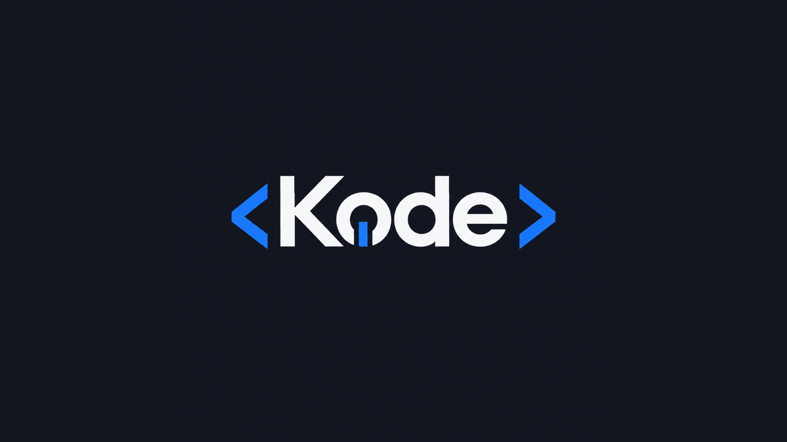

# Kode

**Código com propósito. Aprendizado em evolução.**

---

## Sobre Nós

A **Kode** é uma organização criada para reunir e preservar os projetos desenvolvidos por um grupo de estudantes do curso de **Análise e Desenvolvimento de Sistemas (ADS)** da **FATEC de Itu**, entre os anos de **2026 e 2028**.

Os projetos aqui publicados foram produzidos ao longo da graduação, no contexto de diferentes disciplinas, e refletem a evolução técnica do grupo: dos fundamentos de programação e modelagem de dados até aplicações completas que integram front-end, back-end e banco de dados. Este espaço funciona como um portfólio acadêmico coletivo.

---

## Estrutura dos Projetos

Cada projeto está hospedado em um **repositório independente** dentro da organização, desenvolvido para uma disciplina específica do curso. Os detalhes de cada trabalho, como **propósito, ferramentas utilizadas, instruções de execução e autores**, estão documentados no `README.md` do respectivo repositório.

Acesse o repositório de interesse na aba [**Repositories**](https://github.com/orgs/KodeFatec/repositories).

---

## Principais Tecnologias

Ecossistema utilizado de forma recorrente pelo grupo ao longo do curso:

<!--  -->
<!--  -->

---

## Membros da Equipe

| Nome | GitHub | LinkedIn |
| :--- | :----: | :------: |
| Bryan Castilho Garcia | [@BryanCG2008](https://github.com/BryanCG2008) | [Perfil](https://www.linkedin.com/in/bryan-castilho-garcia-43b022323/) |
| Eduardo Couss de Oliveira | [@couss01](https://github.com/couss01) | [Perfil](https://www.linkedin.com/in/eduardo-couss-de-oliveira-ba08513bb/) |
| João Victor Batista Ferreira | [@jv744t](https://github.com/jv744t) | [Perfil](https://www.linkedin.com/in/) |
| Nicolas Trabachini Spinelli | [@Nicolaspinelli](https://github.com/Nicolaspinelli) | [Perfil](https://www.linkedin.com/in/nicolas-spinelli-33229b38a/) |
| Raphael Scapin Pereira | [@RaphaelScapin](https://github.com/RaphaelScapin) | [Perfil](https://www.linkedin.com/in/raphael-scapin-pereira-0aa023400/) |
| Vinícius de Lucio Porto | [@Vini150cius](https://github.com/vini150cius) | [Perfil](https://www.linkedin.com/in/viniciusdelucioporto) |

---

## Contato

Para **propostas de parceria**, **oportunidades** ou **dúvidas acadêmicas** sobre os projetos, entre em contato com o grupo por meio dos perfis listados na seção [Membros da Equipe](#membros-da-equipe).

© 2026 Kode · FATEC Itu · Análise e Desenvolvimento de Sistemas

